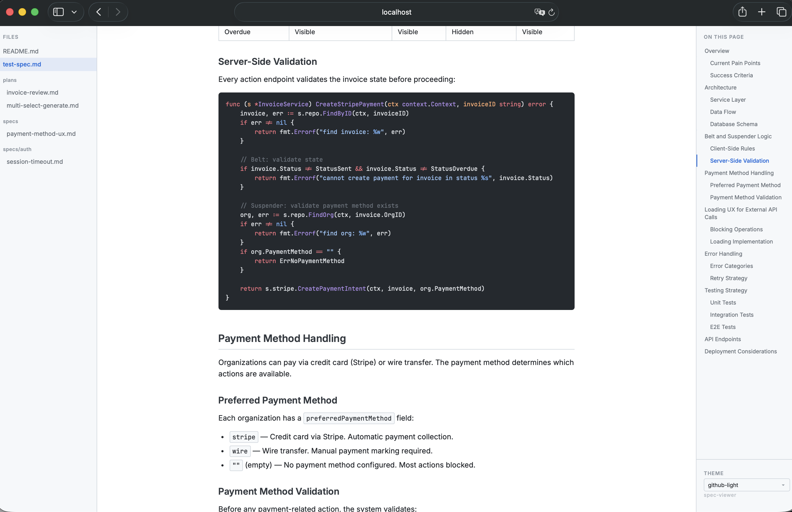

# spec-viewer

[](https://github.com/bzon/spec-viewer/actions/workflows/ci.yml)
[](https://github.com/bzon/spec-viewer/actions/workflows/release.yml)
[](https://goreportcard.com/report/github.com/bzon/spec-viewer)
[](https://opensource.org/licenses/MIT)
[](https://github.com/bzon/spec-viewer/releases/latest)

A local markdown viewer for reading specs, plans, and documentation generated by AI coding agents. Renders markdown in the browser with syntax highlighting, table of contents, configurable themes, live reload, and cross-file search.



## Quick Install

### Homebrew

```bash
brew install bzon/tap/spec-viewer
```

### Go

```bash
go install github.com/bzon/spec-viewer/cmd/spec-viewer@latest
```

## Usage

```bash
# View a single file
spec-viewer README.md

# View a directory of markdown files
spec-viewer docs/

# Use a specific theme
spec-viewer --theme dracula docs/
```

### Search

Press **Cmd+K** (macOS) or **Ctrl+K** to open the search palette. Searches headings, filenames, and full-text content across all files.

### Instance reuse

If spec-viewer is already running, subsequent calls send the file to the existing instance instead of starting a new server.

## Use with AI Agents

This repository includes a portable [Agent Skill](https://agentskills.io) for Claude Code, Codex, Cursor, and other compatible harnesses. Install the binary first, then install the skill:

```bash
npx skills add bzon/spec-viewer --skill spec-viewer -g
```

Ask your agent to open a Markdown file or directory in spec-viewer:

```
Open docs/specs/my-design.md in spec-viewer
```

The skill runs `spec-viewer` through the shell. The viewer opens automatically; later calls reuse the existing browser tab.

### Building your own integration

Agents can also call `spec-viewer` directly:

```bash
# Start server and open file (first call)
spec-viewer /path/to/spec.md
# Output: spec-viewer: serving /path at http://localhost:XXXXX

# Send file to existing server (subsequent calls)
spec-viewer /path/to/another-spec.md
# Output: spec-viewer: sent /path/to/another-spec.md to existing instance on port XXXXX
```

Or use the HTTP API on a running instance:

```bash
curl -X POST http://localhost:PORT/api/open \
  -H 'Content-Type: application/json' \
  -d '{"path": "/absolute/path/to/spec.md"}'
```

## Themes

Five built-in themes: `github-light` (default), `github-dark`, `dracula`, `nord`, `solarized`.

### Set a default theme

Create `~/.config/spec-viewer/config.yaml`:

```yaml
theme: dracula
```

### Custom themes

Drop a `.css` file in `~/.config/spec-viewer/themes/`:

```bash
spec-viewer --print-theme-template > ~/.config/spec-viewer/themes/my-theme.css
# Edit the file, then use: spec-viewer --theme my-theme
```

## Manual Install

Download a release binary directly:

**Download binary:**

```bash
# macOS (Apple Silicon)
curl -sL https://github.com/bzon/spec-viewer/releases/latest/download/spec-viewer_darwin_arm64.tar.gz | tar xz
sudo mv spec-viewer /usr/local/bin/

# macOS (Intel)
curl -sL https://github.com/bzon/spec-viewer/releases/latest/download/spec-viewer_darwin_amd64.tar.gz | tar xz
sudo mv spec-viewer /usr/local/bin/

# Linux (amd64)
curl -sL https://github.com/bzon/spec-viewer/releases/latest/download/spec-viewer_linux_amd64.tar.gz | tar xz
sudo mv spec-viewer /usr/local/bin/
```

## CLI Reference

```
spec-viewer [flags] [path]

Arguments:
  path                     Markdown file or directory (default: current dir)

Flags:
  --theme <name>           Theme name (default: github-light)
  --port <number>          Server port (default: random)
  --host <addr>            Bind address (default: 127.0.0.1)
  --no-open                Don't auto-open the browser
  --print-theme-template   Print CSS custom properties template
  --version                Print version
```

## Features

- Markdown rendering with [markdown-it](https://github.com/markdown-it/markdown-it)
- Mermaid diagram rendering from `mermaid` code blocks
- Syntax highlighting for 25+ languages with [Shiki](https://shiki.style)
- "On this page" TOC with active section tracking
- Live reload on file save
- Tree-grouped file list for directories
- Cmd+K search across headings, filenames, and content
- 5 built-in themes + custom theme support
- Single instance reuse (no duplicate servers)
- Inter + JetBrains Mono fonts embedded
- Keyboard accessible

## License

MIT
