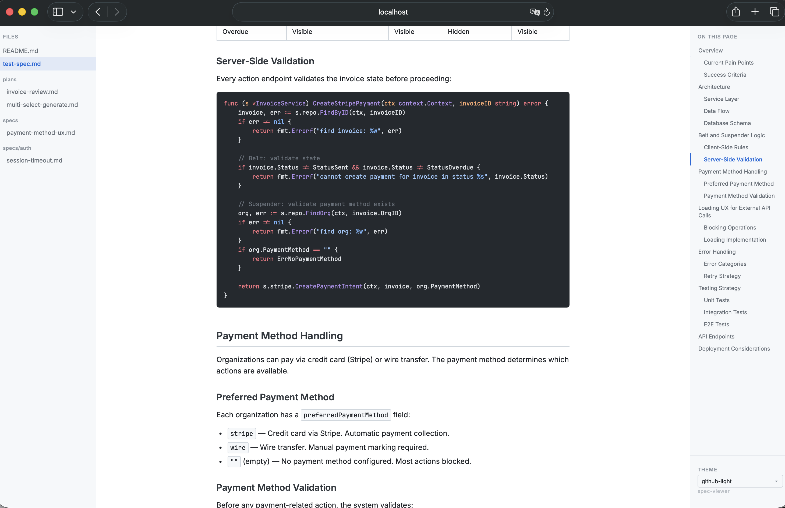

# spec-viewer

[](https://github.com/bzon/spec-viewer/actions/workflows/ci.yml)
[](https://github.com/bzon/spec-viewer/actions/workflows/release.yml)
[](https://goreportcard.com/report/github.com/bzon/spec-viewer)
[](https://opensource.org/licenses/MIT)
[](https://github.com/bzon/spec-viewer/releases/latest)

A local markdown viewer for reading specs, plans, and documentation generated by AI coding agents. Renders markdown in the browser with syntax highlighting, table of contents, configurable themes, live reload, and cross-file search.



## Quick Install

### Homebrew

```bash
brew install bzon/tap/spec-viewer
```

### Go

```bash
go install github.com/bzon/spec-viewer/cmd/spec-viewer@latest
```

## Usage

```bash
# View a single file
spec-viewer README.md

# View a directory of markdown files
spec-viewer docs/

# Use a specific theme
spec-viewer --theme dracula docs/
```

### Search

Press **Cmd+K** (macOS) or **Ctrl+K** to open the search palette. Searches headings, filenames, and full-text content across all files.

### Highlights and comments

Press **H** or click **Highlight** to turn on the marker, then select text with the mouse. Highlights use a readable color for the active theme and stay enabled until you press **H** or **Escape**.

To leave a review comment, just select text with the highlighter off and click the small **Comment** button that appears (or press **C**). Close the box without typing and nothing is kept; closing it after typing saves what you wrote, and an unsent reply is kept until you send it or leave the document. Selections that span several paragraphs, or sit in a code block, become a block comment on the blocks they touch, marked by a thin bar in the left margin. Code blocks and Mermaid diagrams show a quiet **Comment** button on hover or keyboard focus.

Click a highlight or marker to open its thread: the comment with author and time, replies in order, and a reply box (**Ctrl/Cmd+Enter** sends). You can edit your comment, delete replies, or remove the whole thing. The **Comments** list in the right sidebar shows every annotation with a note or replies; click one to jump to it. If the text changed and the anchor is gone, the comment is listed as detached and stays openable.

**Copy feedback** copies a short message for pasting into the agent's terminal as your reply: only comments not yet sent (or all of them again if none is new), each with the text it refers to, your comment and follow-ups, and a closing `curl` command the agent runs to mark them read. Copying marks those comments as sent, and the agent's acknowledgement shows as read in the Comments list and the thread; editing a comment or replying makes it unsent again. Agents can reply on a thread through the API while the viewer is running, and replies appear in the open thread live.

**Clear all** removes every highlight and comment, replies included, from the open document after a confirmation; other documents are not affected.

Annotations are stored privately in your operating system's user-data directory. Markdown files are never modified.

### Instance reuse

If spec-viewer is already running, a later call for any file or folder sends it to the existing instance instead of starting a new server, and opens a browser tab only if none is connected for that folder. The path opens as another folder in the same process, each under its own `/w/<id>/` URL with its own files, comments and live reload. When more than one folder is open, a small Folder selector (top of the file list, or of the right sidebar for a single file) switches between them. This hand-off only works for viewers bound to localhost; a viewer started with a network `--host` does not accept folders from later invocations.

## Use with AI Agents

This repository includes a portable [Agent Skill](https://agentskills.io) for Claude Code, Codex, Cursor, and other compatible harnesses. Install the binary first, then install the skill:

```bash
npx skills add bzon/spec-viewer --skill spec-viewer -g
```

Ask your agent to open a Markdown file or directory in spec-viewer:

```
Open docs/specs/my-design.md in spec-viewer
```

The skill runs `spec-viewer` through the shell. The viewer opens automatically; later calls reuse the existing browser tab.

### pi extension

This repository is also a [pi](https://pi.dev) package that adds `/spec-view` and `/spec-response` commands (and the `spec-viewer` skill). Install the binary first, then:

```bash
pi install git:github.com/bzon/spec-viewer
# or from a local checkout
pi install /path/to/spec-viewer
```

```
/spec-view [path]   open a file or directory (default: the session's working directory)
/spec-view status   list viewers started by this pi session
/spec-view stop     stop viewers started by this pi session
```

`path` is resolved against the session's working directory and may start with `@` or `~`; it must be a directory or a `.md`/`.markdown` file. The binary is found on `PATH`; set `SPEC_VIEWER_BIN` to use another one. `stop` only affects viewers this session started. When pi exits, started viewers keep running so the browser tab stays usable. Output is logged to a file in the OS temp directory.

```
/spec-response          show the latest assistant response and follow the session
/spec-response open     reopen the browser on the latest response
/spec-response status   show whether following is on, the folder, and the viewer URL
/spec-response stop     stop following (files and the viewer stay)
```

`/spec-response` writes each finished assistant response of the session (text only, no thinking or tool calls) as a markdown file, opens the folder in the viewer, and then follows the session: after every agent turn the new response is written and an open tab jumps to it (a closed tab is not reopened). The first call also writes up to 9 earlier responses on the current branch. Following lasts for the current session only and stops on `/new`, `/resume`, `/fork`, reload and exit; run `/spec-response` again to resume. Files are named `<NNN>-<slug>.md` (for example `012-final-answer.md`) and live in `<pi agent dir>/cache/spec-viewer/responses/<project>-<session id prefix>/` (`~/.pi/agent/cache/...` by default, or under `PI_CODING_AGENT_DIR`). The folder is stable per session, so comments and Copy feedback work on responses like on any file. Nothing prunes these folders: delete them when you no longer need them.

### Building your own integration

Agents can also call `spec-viewer` directly:

```bash
# Start server and open file (first call)
spec-viewer /path/to/spec.md
# Output: spec-viewer: serving /path at http://localhost:XXXXX

# Send file to existing server (subsequent calls)
spec-viewer /path/to/another-spec.md
# Output: spec-viewer: sent /path/to/another-spec.md to existing instance on port XXXXX
```

Or use the HTTP API on a running instance. It requires the token stored in the lock file (`~/.config/spec-viewer/instance.json`):

```bash
curl -X POST http://localhost:PORT/api/open \
  -H 'Content-Type: application/json' \
  -H "X-Spec-Viewer-Token: $(jq -r .token ~/.config/spec-viewer/instance.json)" \
  -d '{"path": "/absolute/path/to/spec.md"}'
```

## Themes

Five built-in themes: `github-light` (default), `github-dark`, `dracula`, `nord`, `solarized`.

The theme chosen in the dropdown is remembered in the browser and used in every folder; `config.yaml` and `--theme` set the theme used when nothing is saved.

### Set a default theme

Create `~/.config/spec-viewer/config.yaml`:

```yaml
theme: dracula
```

### Custom themes

Drop a `.css` file in `~/.config/spec-viewer/themes/`:

```bash
spec-viewer --print-theme-template > ~/.config/spec-viewer/themes/my-theme.css
# Edit the file, then use: spec-viewer --theme my-theme
```

## Manual Install

Download a release binary directly:

**Download binary:**

```bash
# macOS (Apple Silicon)
curl -sL https://github.com/bzon/spec-viewer/releases/latest/download/spec-viewer_darwin_arm64.tar.gz | tar xz
sudo mv spec-viewer /usr/local/bin/

# macOS (Intel)
curl -sL https://github.com/bzon/spec-viewer/releases/latest/download/spec-viewer_darwin_amd64.tar.gz | tar xz
sudo mv spec-viewer /usr/local/bin/

# Linux (amd64)
curl -sL https://github.com/bzon/spec-viewer/releases/latest/download/spec-viewer_linux_amd64.tar.gz | tar xz
sudo mv spec-viewer /usr/local/bin/
```

## CLI Reference

```
spec-viewer [flags] [path]

Arguments:
  path                     Markdown file or directory (default: current dir)

Flags:
  --theme <name>           Theme name (default: github-light)
  --port <number>          Server port (default: random)
  --host <addr>            Bind address (default: 127.0.0.1)
  --no-open                Don't auto-open the browser
  --print-theme-template   Print CSS custom properties template
  --version                Print version
```

## Features

- Markdown rendering with [markdown-it](https://github.com/markdown-it/markdown-it)
- Mermaid diagram rendering from `mermaid` code blocks; diagrams that are scaled down to fit can be shown at full size with the **Expand** button that appears on hover
- Syntax highlighting for 25+ languages with [Shiki](https://shiki.style)
- "On this page" TOC with active section tracking
- Live reload on file save
- Tree-grouped file list for directories
- Cmd+K search across headings, filenames, and content
- Persistent personal highlights, review comments with threads, block comments, and a copy-feedback action for agents
- 5 built-in themes + custom theme support
- Single instance reuse (no duplicate servers)
- Inter + JetBrains Mono fonts embedded
- Keyboard accessible

## License

MIT
